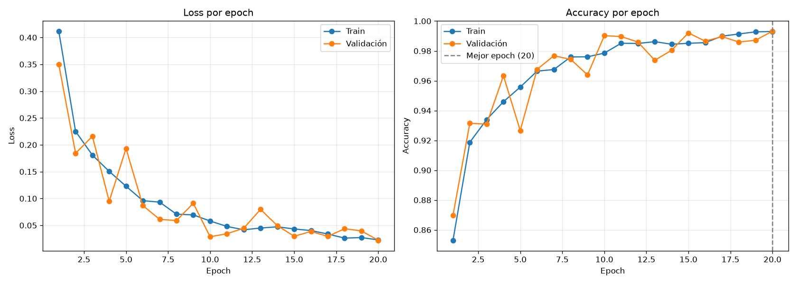
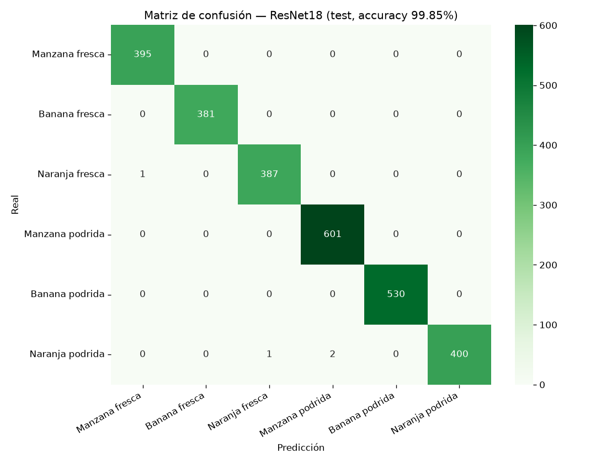

# Clasificador de Frutas Frescas vs Podridas (CNN con PyTorch)

Proyecto final de Inteligencia Artificial (Deep Learning), UTEPSA.

Una red neuronal convolucional que mira una foto de una **manzana, banana o naranja** y decide si está **fresca** o **podrida**. **Caso de uso:** control de calidad en mercados o plantas de empaque, donde una cámara decide si la fruta se **vende** o se **descarta**.

Incluye una **página de cámara en vivo** que detecta la fruta en tiempo real dentro del navegador, sin servidor de IA.

---

## Resultados

| Modelo | Test de Kaggle | Parámetros | Tamaño | Entrenamiento | Inferencia (CPU) |
|---|---:|---:|---:|---:|---:|
| CNN propia (`Net`, notebook 01) | 99.07% | 16.9 M | 67.5 MB | 3.0 min (20 epochs) | 2.6 ms |
| ResNet18, transfer learning (notebook 02) | **99.85%** | 11.2 M | 44.8 MB | 1.4 min (7 epochs) | 12.9 ms |
| ResNet18 + fotos propias + clase "nada" (notebook 03) | 99.85% | 11.2 M | 44.8 MB | 1.5 min (7 epochs) | — |

Entrenado en una RTX 4070 Laptop (8 GB).

**Lección principal del proyecto:** el 99% en el test de Kaggle **no** significaba que el modelo funcionara con una webcam real. Hubo dos causas:
1. **Data leakage:** ~89% de las imágenes del dataset son copias aumentadas por el autor (`rotated_by_15_…`, `vertical_flip_…`, `saltandpepper_…`, etc.), y **las 2,698 imágenes de test son variantes de fotos que también están en train**.
2. **Domain shift:** las fotos de Kaggle son de estudio, con fondo blanco. Con la webcam (otro fondo, otra luz, naranjas verdes locales) el modelo fallaba.

La solución fue capturar **fotos propias** con la webcam (`src/capturar.py`), agregar una clase **"nada"** (sin fruta), usar un augmentation más fuerte y reentrenar. Además se evaluó con un test de fotos propias separado **por tiempo**, para no repetir el leakage. Ver el notebook 03.

| Prueba en fotos propias de test (9 fotos, webcam) | ANTES (solo Kaggle) | DESPUÉS (+ 26 fotos propias) |
|---|---:|---:|
| Accuracy | 66.7% (6 de 9) | **100%** (9 de 9) |

Son pocas fotos (35 en total), así que la mejora es clara pero la muestra es chica. El siguiente paso sería capturar cientos de fotos variadas, incluidas manzanas y bananas podridas reales.

<p>
  
  
</p>

---

## Arquitectura

**CNN propia (`src/modelo.py`)**, la del maestro adaptada a 6 clases:
```
Entrada (3, 128, 128)
 → [Conv 3x3 (32)  → BatchNorm → ReLU → MaxPool 2x2]  → (32, 64, 64)
 → [Conv 3x3 (64)  → BatchNorm → ReLU → MaxPool 2x2]  → (64, 32, 32)
 → [Conv 3x3 (128) → BatchNorm → ReLU → MaxPool 2x2]  → (128, 16, 16)
 → Aplanar (32,768) → Dropout(0.25)
 → Linear 32768→512 → BatchNorm → ReLU → Dropout
 → Linear 512→6 (logits)
```
El 99.4% de los parámetros está en la primera capa `Linear` (32,768 × 512).

**ResNet18:** preentrenada en ImageNet. Etapa 1: se congela toda la red y se entrena solo la capa final nueva (`fc: 512 → n_clases`). Etapa 2: *fine-tuning* de los últimos bloques con un learning rate 10 veces menor.

---

## Estructura

```
notebooks/
  01_frutas_cnn.ipynb                 CNN desde cero (pipeline del maestro + validación, curvas, errores, feature maps)
  02_frutas_transfer_learning.ipynb   ResNet18 + tabla comparativa
  03_frutas_fotos_propias.ipynb       Reentrenamiento con fotos propias, clase "nada", antes vs después
src/
  modelo.py      Clase Net (generada desde el notebook 01)
  datos.py       Dataset a partir de una lista de (ruta, etiqueta) (generado desde el notebook 03)
  predecir.py    cargar_modelo() y predecir(img) -> {clase: probabilidad}; también se usa desde la terminal
  exportar.py    Exporta el modelo del config a ONNX y verifica que coincide con PyTorch
  capturar.py    Toma fotos con la webcam para crear el dataset propio
app/app.py       App Gradio (subir foto o webcam)
web/index.html   Cámara en vivo en el navegador (onnxruntime-web) + subir foto
web/servir.py    Servidor local para la página
models/config.json   Modelo activo: clases, tamaño, normalización, archivos de pesos
outputs/         Figuras y métricas reales de cada notebook
```

---

## Cómo correrlo (Windows)

```powershell
py -3.13 -m venv .venv
.\.venv\Scripts\activate
pip install torch torchvision --index-url https://download.pytorch.org/whl/cu130
pip install -r requirements.txt
python -m ipykernel install --user --name frutas-cnn --display-name "Python (frutas-cnn)"
```

**Dataset:** [Fruits fresh and rotten for classification](https://www.kaggle.com/datasets/sriramr/fruits-fresh-and-rotten-for-classification) (Kaggle). Hay que descomprimirlo en `data/train` y `data/test`. Viene duplicado en `dataset/dataset/`; basta con una copia.

**Entrenar:** abre los notebooks en orden (01 → 02 → 03) con el kernel "Python (frutas-cnn)" y ejecuta *Run All*. Para el 03, primero captura fotos:
```powershell
python src/capturar.py        # teclas 0-6 graban 20 s de cada clase en data/propias/
```

**Usar el modelo** (los archivos `.pth` y `.onnx` no están en el repo porque pesan ~45 MB cada uno; se generan al correr los notebooks):
```powershell
python web/servir.py                  # Cámara en vivo: http://localhost:8000/web/
python app/app.py                     # App Gradio: http://127.0.0.1:7860
python src/predecir.py foto.jpg       # Terminal
```

---

## Tecnologías
PyTorch 2.14 (CUDA 13.0) · torchvision · scikit-learn · matplotlib/seaborn · ONNX + onnxruntime / onnxruntime-web · Gradio · OpenCV
